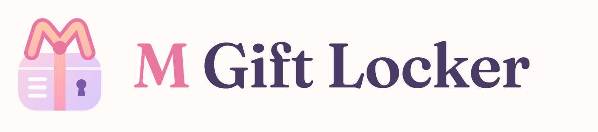

<p align="center"></p>

# My Gift Locker — mygiftlocker.com

Keep everyone's sizes, addresses and special dates in one place — and run joyful gift exchanges.

## What's here

```
apps/
  web/        Next.js 16 (App Router, React 19, Tailwind 4, Motion) — mygiftlocker.com
  mobile/     Expo SDK 58 (React Native 0.88, Expo Router, Reanimated 4) — iPhone, iPad, Android
packages/
  core/       Shared domain logic: sizes + conversions, dates, invites, step config, draw-names matcher
  brand/      Logo (SVG + PNG), design tokens
amplify/      AWS Amplify Gen 2 backend: Cognito auth (Google, Facebook, email codes), data models, draw function
docs/         Architecture notes, kids-profile proposal, design references
```

## Run it

```bash
pnpm install
```

```bash
pnpm dev            # web on http://localhost:3000
```

```bash
pnpm dev:mobile     # Expo dev server; first native build: pnpm --filter @mgl/mobile ios
```

```bash
pnpm test           # core unit tests (matcher, conversions, dates, invites)
```

```bash
pnpm typecheck      # all packages
```

The web and mobile apps run in **demo mode** out of the box: data is kept on the device
(localStorage on web, in-memory on mobile) and sign-in is simulated. To go live, deploy
the Amplify backend — see [docs/architecture.md](docs/architecture.md#going-live-with-amplify).

## Key flows (web)

| Route | What it does |
|---|---|
| `/` | Landing page |
| `/invite` | Build an invite (choose what to ask for) → share by link, text, email, WhatsApp, Messenger, QR or share sheet |
| `/join/[token]` | The invitee's animated step form: sizes (US/UK/EU/JP), address, birthday/anniversary (year optional), favorites, kids |
| `/locker` | Your people; tap a card for a hero transition into their details |
| `/exchange` | Start a gift exchange |
| `/exchange/[id]` | Organizer: participants, exclusions, draw names, private links |
| `/exchange/[id]/join` | Join + add your top-N wishes |
| `/exchange/[id]/me/[token]` | Your private page: edit wishes, reveal your match |
| `/sign-in` | Google / Facebook / email |

## Design

Soft pastel "clay" look (cream surfaces on a dusty-rose wash, peach + blush + powder blue,
wide soft shadows, floating spheres). Motion uses one long ease-out curve
(`cubic-bezier(0.16, 1, 0.3, 1)`) with no bounce, transform/opacity only, and respects
reduced-motion. The reference pins are in `docs/references/`.
